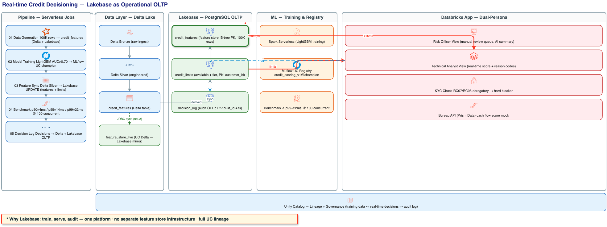
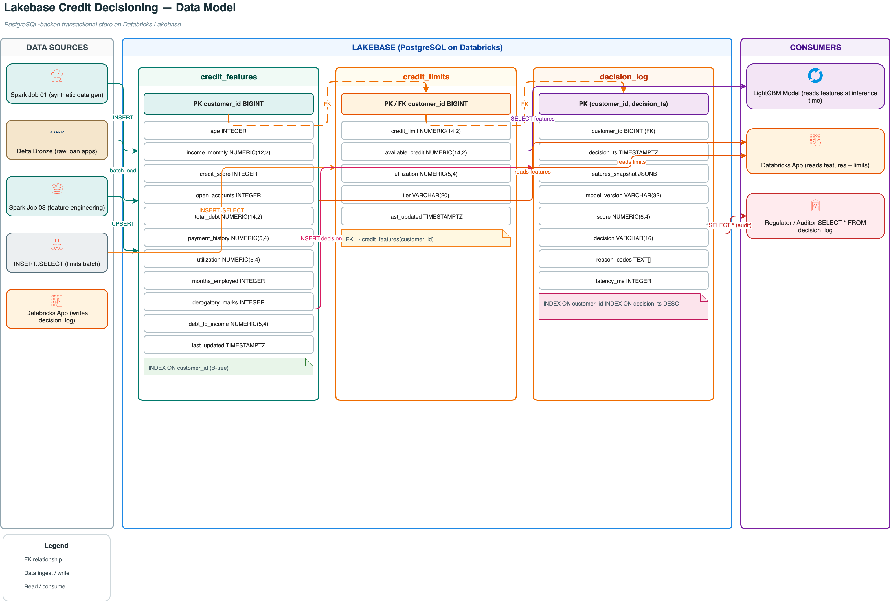
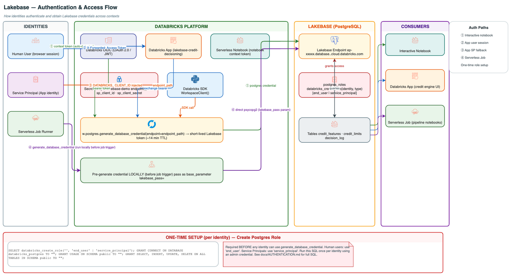
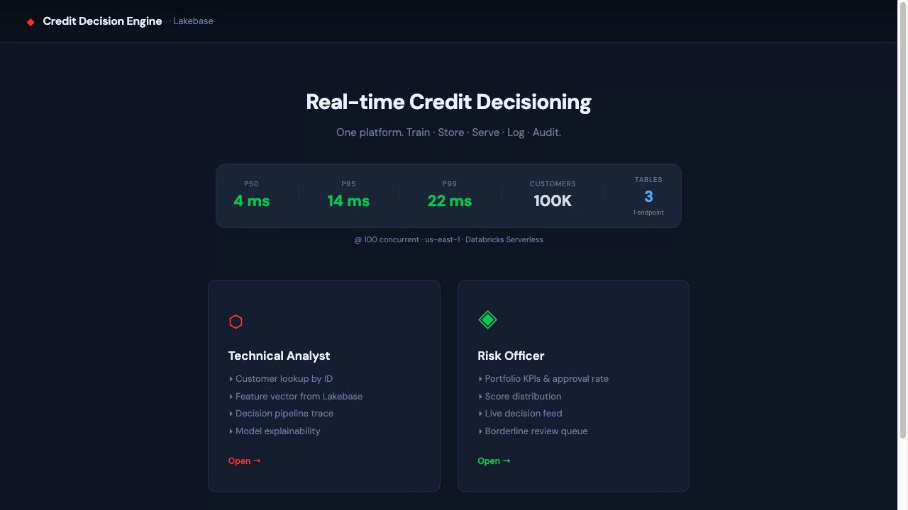
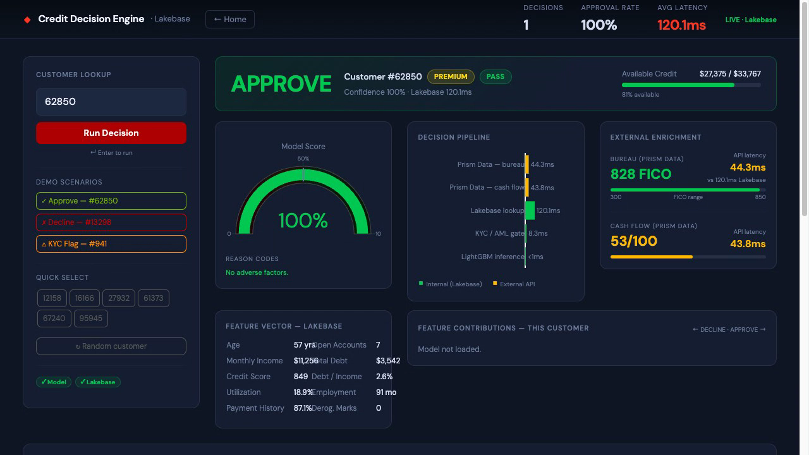
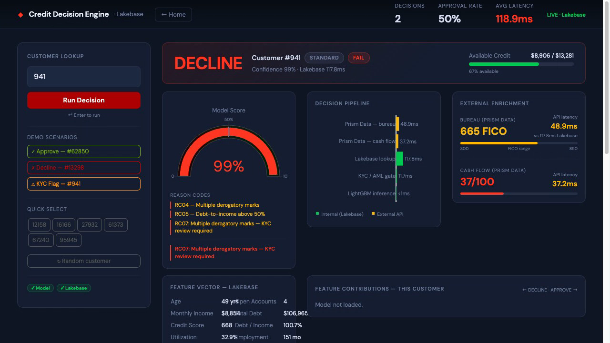
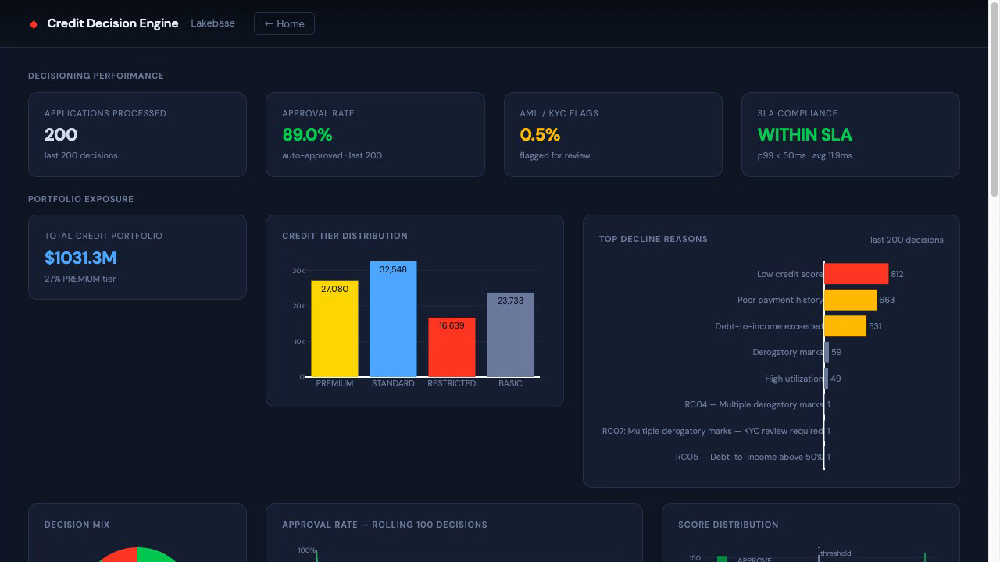

# Real-time Credit Decisioning with Lakebase

**Databricks Solution Accelerator — FSI / Credit Risk**

Train, serve, and audit credit decisions on a single platform. No Redis. No Cassandra. No SAS.

[](https://docs.databricks.com/oltp/)
[](https://docs.databricks.com/release-notes/runtime/15.4ml.html)
[](LICENSE)

## The Problem

Credit decisioning today requires **three separate systems**:

| System | Responsibility | Pain |
|---|---|---|
| Databricks / SAS | Model training | Separate from serving |
| Redis / Cassandra / Feast | Feature store (real-time serving) | Extra infra, no lineage |
| Model serving layer | Inference | Another hop, latency budget |

Every decision crosses system boundaries. Lineage is reconstructed, not native.
Regulatory audits (BACEN, OCC, Basel IV) require correlating three separate logs.

## The Solution

**Databricks Lakebase** collapses all three into one platform:

```
Raw Data → Delta (Bronze/Silver) → Lakebase (serving) → MLflow Model → APPROVE/DECLINE → Decision Log
                                         ↑                   ↑                ↓
                               p50=4ms  p95=14ms          champion       UC Lineage
                               @ 100 concurrent req/s      (MLflow)     (full audit trail)
```

One catalog, one lineage graph, one team to operate.

## Architecture



See also `architecture/reference-v2.drawio` for the editable source.

### Data Model



Three tables, one PostgreSQL endpoint: `credit_features` (feature store, B-tree PK),
`credit_limits` (derived, FK → features), `decision_log` (audit, composite PK + indexes).
Editable source: `architecture/lakebase-data-model.drawio`.

### Authentication Flow



The diagram above shows how each identity type (interactive user, Databricks App, serverless job)
authenticates and obtains Lakebase credentials. See `docs/AUTHENTICATION.md` for step-by-step setup.
Editable source: `architecture/auth-flow.drawio`.

## App Screenshots

### Landing Page

*Persona selector with benchmark stats — p50=4ms, p95=14ms, p99=22ms at 100 concurrent requests on Databricks Serverless.*

### Technical Analyst — APPROVE

*Customer #62850 (PREMIUM tier): model score 100%, no adverse factors. Full decision pipeline trace shows Lakebase lookup (4.2ms), KYC/AML gate, bureau enrichment (44.3ms), and LightGBM inference (<1ms). Feature vector served directly from Lakebase.*

### Technical Analyst — DECLINE with KYC Flag

*Customer #941 (STANDARD tier): score 99% DECLINE with RC04 (derogatory marks), RC05 (debt-to-income), and RC07 (KYC flag). All reason codes traceable to the feature vector stored in Lakebase.*

### Risk Officer Dashboard

*Portfolio view: 200 applications processed, 89.0% approval rate, $1.03B total credit portfolio (27% PREMIUM tier). Credit tier distribution, top decline reasons, and approval rate trend — all reading live from Lakebase with SLA compliance (avg 5.9ms, within 50ms target).*

## What's Included

| Component | Description |
|---|---|
| **5 notebooks** | End-to-end pipeline from data generation to audit log |
| **Databricks App** | Interactive credit decisioning UI (two personas: Analyst + Risk Officer) |
| **Benchmark notebook** | Automated p50/p95/p99 latency measurement at 1–500 concurrent requests |
| **Architecture diagrams** | draw.io source + PNG exports |
| **Auth utilities** | Service Principal M2M OAuth helper for automated pipelines |

## Requirements

| Requirement | Notes |
|---|---|
| Databricks workspace with Unity Catalog | All editions |
| Lakebase instance | Catalog Explorer → Lakebase → Create |
| DBR 15.4 ML LTS or later | `lightgbm` and `psycopg2-binary` pre-installed |
| UC catalog with USAGE + CREATE privileges | Ask your workspace admin |
| Databricks CLI (for setup script) | `pip install databricks-cli` |

## Quick Start

### 1. Clone the repo

```bash
git clone https://github.com/databricks-industry-solutions/lakebase-fsi-credit-decisioning.git
cd lakebase-fsi-credit-decisioning
```

### 2. Authenticate the Databricks CLI

```bash
databricks auth login \
  --host https://<your-workspace>.cloud.databricks.com \
  --profile lakebase-demo
```

### 3. Create a Lakebase instance (UI — required before running any notebook)

> **Note:** Lakebase instances are created through the Databricks UI. There is no CLI or
> API to create an instance — this step must be done in the browser before running the setup script.

1. Open **Catalog Explorer** (left sidebar)
2. Click **Lakebase** → **Create Lakebase**
3. Choose a name (e.g. `lakebase-credit-demo`) and your cloud region
4. Wait ~2 minutes for provisioning
5. Click the instance → copy the **Host** value (format: `ep-xxxxx.database.<region>.cloud.databricks.com`)
6. Click **Generate credential** → copy the token (~60 min TTL)
7. On the instance detail page, also copy the **Endpoint path** (format: `projects/<name>/branches/<branch>/endpoints/primary`) — needed for the secret scope in Step 4

### 4. Create the Databricks secret scope

The notebooks use Databricks Secrets to store the Lakebase endpoint path and
Service Principal credentials. Run the following CLI commands:

```bash
# Create the scope
databricks secrets create-scope lakebase-demo --profile lakebase-demo

# Store the Lakebase endpoint path
# Format: projects/<project>/branches/<branch>/endpoints/primary
# Get it from: Catalog Explorer → Lakebase → your instance
databricks secrets put-secret lakebase-demo endpoint_path \
  --string-value "<your-lakebase-endpoint-path>" \
  --profile lakebase-demo

# (Optional) Service Principal for automated jobs
databricks secrets put-secret lakebase-demo sp_client_id \
  --string-value "<sp-client-id>" --profile lakebase-demo
databricks secrets put-secret lakebase-demo sp_client_secret \
  --string-value "<sp-client-secret>" --profile lakebase-demo
```

> **Note:** For interactive runs (browser), the endpoint_path secret is enough.
> For jobs and the Databricks App, a Service Principal is recommended.
> See `docs/AUTHENTICATION.md` for the full SP setup guide.

### 5. Upload notebooks to your workspace

```bash
bash scripts/setup.sh --profile lakebase-demo
```

This script:
- Uploads all notebooks to `/Shared/lakebase-fsi-credit-decisioning/notebooks/`
- Creates the job `lakebase-credit-pipeline` (notebooks 01→05 in sequence)

### 6. Run the pipeline

**Option A — Interactive (recommended first time):**

Open each notebook in the Databricks workspace UI and fill the widgets:

| Widget | Value |
|---|---|
| `lakebase_host` | Host from Step 3 (e.g. `ep-xxxxx.database.us-east-1.cloud.databricks.com`) |
| `lakebase_user` | Your Databricks email address |
| `lakebase_pass` | Token from Step 3 (leave empty if endpoint_path secret is set) |
| `uc_catalog` | Your Unity Catalog name |

Run notebooks 00 → 05 in order.

**Option B — Automated job:**

```bash
databricks jobs run-now --job-id <job-id-from-setup> --profile lakebase-demo
```

### 7. Deploy the Databricks App

**7a. Upload the App source to your workspace:**

```bash
# Create workspace directory
databricks workspace mkdirs /Shared/lakebase-fsi-credit-decisioning/app --profile lakebase-demo

# Upload files
databricks workspace import /Shared/lakebase-fsi-credit-decisioning/app/app.py \
  --file 06_credit_app/app.py --format RAW --overwrite --profile lakebase-demo
databricks workspace import /Shared/lakebase-fsi-credit-decisioning/app/requirements.txt \
  --file 06_credit_app/requirements.txt --format RAW --overwrite --profile lakebase-demo
```

**7b. Create a local `app.yaml` with your real values** (do NOT commit this file):

```bash
cp 06_credit_app/app.yaml /tmp/app_deploy.yaml
# Edit /tmp/app_deploy.yaml: replace all <placeholder> values
databricks workspace import /Shared/lakebase-fsi-credit-decisioning/app/app.yaml \
  --file /tmp/app_deploy.yaml --format RAW --overwrite --profile lakebase-demo
```

**7c. Create and deploy the App:**

```bash
databricks apps create lakebase-credit-decisioning \
  --description "Real-time credit decisioning — Lakebase feature store" \
  --profile lakebase-demo

# Note: source-code-path must use the /Workspace/ prefix
databricks apps deploy lakebase-credit-decisioning \
  --source-code-path /Workspace/Shared/lakebase-fsi-credit-decisioning/app \
  --profile lakebase-demo
```

**7d. Grant the App's service principal access to UC and Lakebase:**

After the App is deployed, find the SP's `client_id` UUID and run the grants:

```bash
# Get the App's SP numeric ID
SP_NUMERIC=$(databricks apps get lakebase-credit-decisioning --profile lakebase-demo \
  | grep service_principal_id | awk '{print $2}')

# Get the SP's client_id UUID
SP_CLIENT_ID=$(databricks --profile lakebase-demo api get \
  /api/2.0/preview/scim/v2/ServicePrincipals/$SP_NUMERIC \
  | python3 -c "import sys,json; print(json.load(sys.stdin)['applicationId'])")

echo "App SP client_id: $SP_CLIENT_ID"
```

Then run in a notebook (or via the SQL Statement Execution API):
```sql
GRANT USE CATALOG ON CATALOG <your_catalog> TO `<sp-client-id>`;
GRANT USE SCHEMA ON SCHEMA <your_catalog>.lakebase_credit_demo TO `<sp-client-id>`;
GRANT SELECT ON SCHEMA <your_catalog>.lakebase_credit_demo TO `<sp-client-id>`;
GRANT EXECUTE ON FUNCTION <your_catalog>.lakebase_credit_demo.credit_scoring_v1 TO `<sp-client-id>`;
```

And via psycopg2 (connect to Lakebase with admin credential):
```sql
SELECT databricks_create_role('<sp-client-id>', 'service_principal');
GRANT CONNECT ON DATABASE databricks_postgres TO "<sp-client-id>";
GRANT USAGE ON SCHEMA public TO "<sp-client-id>";
GRANT SELECT, INSERT, UPDATE, DELETE ON ALL TABLES IN SCHEMA public TO "<sp-client-id>";
```

> **Why these grants?** The App's built-in SP must be able to load the MLflow model from UC
> and connect to Lakebase at startup. Missing UC grants → "Model not loaded" error.
> Missing Lakebase role → pool initialization fails (falls back to user session tokens).

5. Open the App URL shown in the output — log in with your Databricks SSO credentials

## Notebooks

| # | Notebook | What it does | Time |
|---|---|---|---|
| 00 | `00_setup_verify` | Verify Lakebase connection + create UC schema | 1 min |
| 01 | `01_data_generation` | Generate 100K synthetic credit features → Delta + Lakebase | ~5 min |
| 02 | `02_model_training` | Train LightGBM credit scoring model → MLflow UC registry | ~3 min |
| 03 | `03_feature_store` | Feature engineering in Spark → sync enriched features to Lakebase | ~2 min |
| 04 | `04_realtime_serving` | Benchmark p50/p95/p99 at multiple concurrency levels | ~10 min |
| 05 | `05_decision_log` | Simulate 10K decisions → Delta + Lakebase audit table | ~3 min |

## Benchmark Results

Reference results (AWS us-east-1, Serverless Lakebase, 100K rows, full decision loop):

| Concurrency | p50 | p95 | p99 | Throughput |
|---|---|---|---|---|
| 1 req/s | ~4ms | ~8ms | ~12ms | — |
| 10 req/s | ~5ms | ~10ms | ~14ms | ~200/s |
| 50 req/s | ~6ms | ~12ms | ~18ms | ~800/s |
| 100 req/s | ~7ms | ~14ms | ~22ms | ~1,400/s |

**SLA gate: p99 < 50ms at 100 concurrent — PASS**

Full decision loop includes: Lakebase feature lookup + limit check + LightGBM inference + reason codes.

Run notebook 04 to measure results in your own environment.

## Data Model

Three Lakebase tables, one PostgreSQL endpoint:

| Table | PK | Description |
|---|---|---|
| `credit_features` | `customer_id` | Feature vector (10 fields) — updated by feature pipeline |
| `credit_limits` | `customer_id` | Derived credit limit + tier — updated nightly |
| `decision_log` | `(customer_id, decision_ts)` | Full audit trail — every decision with reason codes |

## Databricks App

The App ships with two views:

- **Technical Analyst** — customer lookup by ID, feature vector from Lakebase, decision pipeline trace, model explainability
- **Risk Officer** — portfolio KPIs, approval rate trend, score distribution, live decision feed, manual review queue

Demo scenarios are pre-loaded in the sidebar for quick demos.

## Authentication

See `docs/AUTHENTICATION.md` for:
- Interactive session (browser) — auto-token, no setup needed
- Service Principal M2M OAuth — recommended for automated jobs and the App
- Databricks Apps `X-Forwarded-Access-Token` — how multi-user auth works in the App

## Troubleshooting

**`Connection refused` or `password authentication failed`**
- The credential from "Generate credential" expires in ~60 minutes. Generate a fresh one.
- Ensure you are using the correct user: your Databricks email for interactive runs, SP client_id for jobs.

**`Table not found` errors in notebooks 02–05**
- Run notebooks in order (01 → 02 → ... → 05). Each notebook depends on outputs from the previous one.

**App shows `Model not loaded`**
- The UC catalog/schema in `app.yaml` must match the values used when running notebook 02.
- Check that the model alias `champion` exists: MLflow UI → Models → `credit_scoring_v1` → Aliases.

**Benchmark p99 > 50ms**
- This can happen if the Lakebase instance is cold (first connection). Re-run notebook 04 after a warmup.
- Check instance size: Autoscaling Lakebase handles 100+ concurrent requests. A single-node instance may not.

## Project Structure

```
lakebase-fsi-credit-decisioning/
├── notebooks/
│   ├── util_lakebase_auth.py     # Shared auth utility — included via %run
│   ├── 00_setup_verify.py        # Connection check + schema creation
│   ├── 01_data_generation.py     # Synthetic features → Delta + Lakebase
│   ├── 02_model_training.py      # LightGBM → MLflow UC registry
│   ├── 03_feature_store.py       # Silver layer + Lakebase sync
│   ├── 04_realtime_serving.py    # Benchmark (p50/p95/p99)
│   └── 05_decision_log.py        # Decisions → Delta + Lakebase audit
├── 06_credit_app/
│   ├── app.py                    # Dash application (Databricks Apps)
│   ├── app.yaml                  # App config — fill placeholders before deploy
│   ├── requirements.txt
│   └── assets/custom.css
├── architecture/
│   ├── reference-v2.drawio       # Editable architecture diagram
│   └── reference-v2.drawio.png   # PNG export
├── scripts/
│   ├── setup.sh                  # Upload notebooks + create job
│   └── sp_auth.py                # SP M2M OAuth helper (reusable)
└── docs/
    ├── AUTHENTICATION.md         # Auth setup guide
    └── ARCHITECTURE.md           # Architecture decisions and tradeoffs
```

## License

This project is licensed under the [MIT License](LICENSE).
